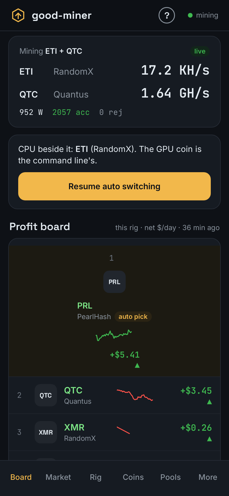
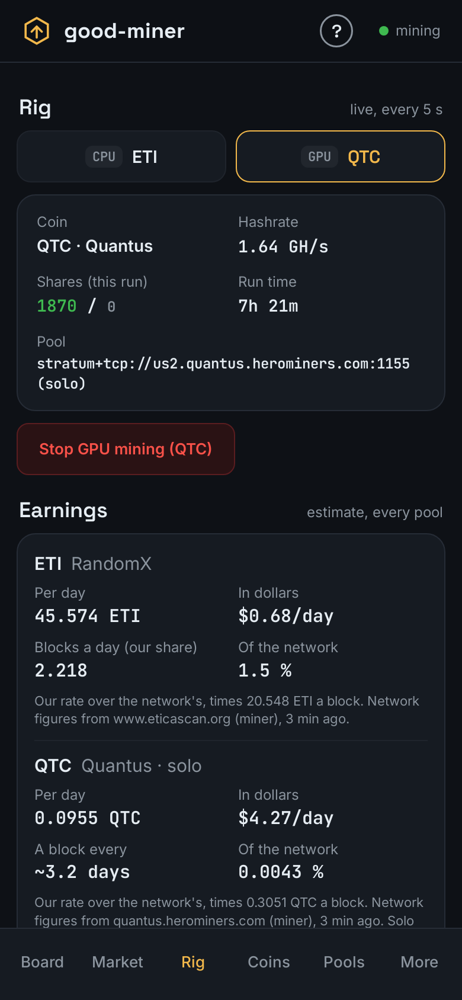
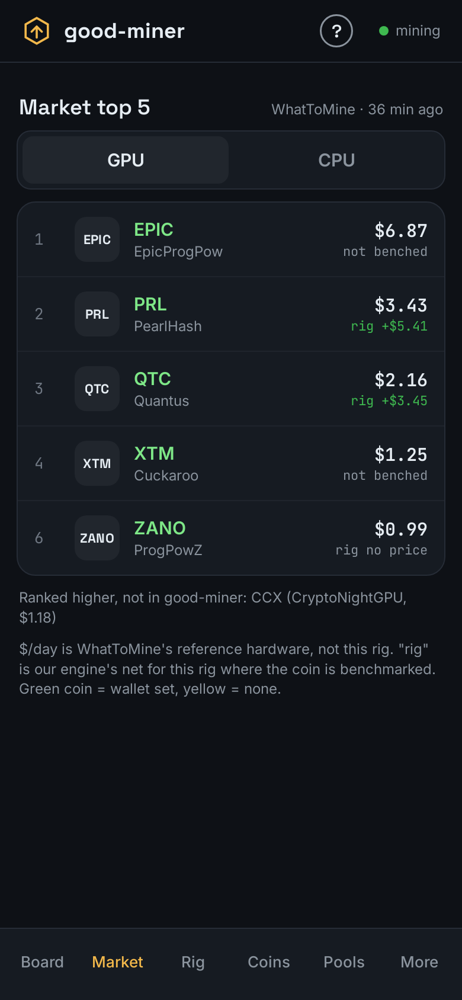

# good-miner

A cryptocurrency miner written from scratch in Rust. One binary mines on NVIDIA cards, AMD cards and CPUs, on
Windows and Linux, and brings its own web dashboard.

> **Public beta.** It mines around the clock on our own rig, but it has seen few machines besides ours.
> Expect rough edges, and tell us about them: [open an issue](../../issues/new/choose).

- **Download:** the first public beta is being prepared. It will appear under [Releases](../../releases),
  with checksums (see [SECURITY.md](SECURITY.md)).
- **Website:** https://good-miner.com (coming with the release)
- **Questions and bug reports:** [issues](../../issues)

## Why good-miner

- **One miner for the whole rig.** NVIDIA, AMD and CPU in one program; different coins on different cards, a
  CPU coin beside a GPU coin, all on one dashboard.
- **It picks the coin for you.** `mine auto` ranks every coin by what *your* cards measured, the coin's live
  network figures and price, and your power cost, then mines the best one and switches when the ranking
  changes. Or tap a coin on the dashboard and the rig switches.
- **A dashboard in your pocket.** Built in, no account, no cloud: pair your phone with a 6-digit code.
- **It looks after the hardware.** Per-card temperature guards, a watcher that restarts a crashed miner and
  stops one that is sending bad work, fans and clocks put back on exit.
- **Runs the new cards.** RTX 50-series and RX 9070 are first-class, including on Linux.
- **A fee you can read.** Published per algorithm and printed by the miner itself.

<p align="center">
  
  
  
</p>

<p align="center"><em>The built-in dashboard on a phone: the profit board with its auto pick, the rig, and the market.</em></p>

## What it mines

Every coin below has had shares accepted by a real pool from this miner. GPU coins run on NVIDIA and AMD
cards unless the release notes say otherwise.

| coin | ticker | algorithm | mines on |
| --- | --- | --- | --- |
| Abelian | ABEL | AbelHash | GPU |
| Aeternity | AE | CuckooAe | GPU |
| Alephium | ALPH | Blake3Alephium | GPU |
| Beam | BEAM | BeamHashIII | GPU |
| Conflux eSpace | CFX | octopus | GPU |
| Cryptix | CPAY | CryptixHash | GPU |
| Decred | DCR | Blake3PoW | GPU |
| Etica | EGAZ | Etchash | GPU |
| Epic Cash | EPIC | EpicProgPow | GPU |
| Ergo | ERG | Autolykos | GPU |
| Ethereum Classic | ETC | Etchash | GPU |
| Evrmore | EVR | EvrProgPow | GPU |
| Frencoin | FREN | KawPow | GPU |
| Grin | GRIN | Cuckatoo32 | GPU |
| Hoosat | HTN | HooHash | GPU |
| Kerrigan | KRGN | KawPow | GPU |
| Kerrigan | KRGN | Equihash192_7 | GPU |
| Parallax | LAX | XHash | GPU |
| Meowcoin | MEWC | MeowPow | GPU |
| MimbleWimbleCoin | MWC | Cuckatoo31 | GPU |
| Neoxa | NEOX | KawPow | GPU |
| Nexa | NEX | Nexapow | GPU |
| Pearl | PRL | PearlHash | GPU |
| Qubitcoin | QTC | Qhash | GPU |
| Quantus Network | QTC | Quantus | GPU |
| Ravencoin | RVN | KawPow | GPU |
| SmartCore | SMC | Ethash | GPU |
| Telestai | TLS | ProgPowTelestai | GPU |
| Vertcoin | VTC | Verthash | GPU |
| Waglayla | WALA | WalaHash | GPU |
| Warthog | WART | Janushash | GPU |
| Bitcoin BLAKE2b | XBT | Blake2bXbt | GPU |
| Xelis | XEL | XelisHash | GPU |
| Neurai | XNA | KawPow | GPU |
| Tari | XTM | SHA-3X | GPU |
| Tari | XTM | Cuckaroo | GPU |
| Zano | ZANO | ProgPowZ | GPU |
| AdventureCoin | ADVC | YespowerADVC | CPU |
| Babacoin | BBC | GhostRider | CPU |
| DERO | DERO | AstroBWTv3 | CPU |
| Epic Cash | EPIC | RandomX | CPU |
| Etica | ETI | RandomX | CPU |
| Mytherra | MYT | RandomX | CPU |
| Quantum Resistant Ledger | QRL | RandomX | CPU |
| Ratatoskr | RATR | Yespower | CPU |
| Rincoin | RIN | RinHash | CPU |
| Rhino | RMC | YespowerR16 | CPU |
| Raptoreum | RTM | GhostRider | CPU |
| Salvium | SAL | RandomX-Salvium | CPU |
| Sugarchain | SUGAR | YespowerSugar | CPU |
| UraniumX | URX | YespowerURX | CPU |
| Dagger | XDAG | RandomX | CPU |
| Monero | XMR | RandomX | CPU |
| Zephyr | ZEPH | RandomX-Zephyr | CPU |

## What you need

| | |
| --- | --- |
| Operating system | Windows 10 or 11 (64-bit); a current 64-bit Linux |
| NVIDIA | a current driver (the release notes give the minimum) |
| AMD | a current Adrenalin (Windows) or ROCm / amdgpu OpenCL (Linux) driver |
| CPU | any x86-64 CPU; the `v3` download needs AVX2 (Intel Haswell 2013, AMD Zen, or newer), `v2` runs on older ones |

## Quick start

good-miner takes plain words, no dashes.

```text
good-miner-cli mine xmr wallet <your address>
good-miner-cli mine rvn url stratum.ravenminer.com:3838 wallet <your address> pass x
good-miner-cli ui mine qtc wallet <your address>        # with the terminal UI
good-miner-cli no gpu 0,1 mine rvn wallet <your address> # leave out GPUs 0 and 1
good-miner-cli help                                      # everything else
```

Give your own wallet address on the command line, as above.

### Let it choose

```text
good-miner-cli util benchmark rvn        # measure your cards on a coin, once
good-miner-cli config set kwh 0.18       # your electricity price
good-miner-cli util profit               # the ranking for this rig
good-miner-cli mine auto                 # mine the best coin you have a wallet for, and keep it the best
```

## Documentation

| | |
| --- | --- |
| [Getting started](docs/getting-started.md) | from download to the first accepted share |
| [Coins](docs/coins.md) | every coin with a ready command line |
| [Cards, temperatures and overclock](docs/gpus-and-cooling.md) | choosing cards, two coins on one rig, fans, the memory tune |
| [CPU mining](docs/cpu-mining.md) | threads, huge pages, RandomX speed |
| [Dashboard, profit and the API](docs/dashboard.md) | phone pairing, `mine auto`, power price |
| [Commands](docs/commands.md) | every command and word |
| [HiveOS](docs/hiveos.md) | running it as a custom miner |
| [Troubleshooting](docs/troubleshooting.md) | exit codes and the usual problems |
| [FAQ](docs/faq.md) | fee, closed source, antivirus, pool or solo |

## Developer fee

good-miner is free to use. It pays for its development with a fee: for a small part of the time it mines for
us instead of you. The rate depends on the algorithm and is fixed in each release:

| algorithms | fee |
| --- | --- |
| Ethash, Etchash | 0.65 % |
| kHeavyHash family | 0.75 % |
| RandomX, CryptoNight, Yespower, KawPow / ProgPoW, FishHash, BLAKE3 | 0.85 % |
| Cuckoo family, Octopus | 1.5 % |
| everything else | 1 % |

`good-miner-cli list algorithms` prints the rate for every algorithm in your copy.

## Performance

We publish only numbers we measured ourselves with the release binary, on the card named, beside the best
other miner we could run on the same card that day.

| card | coin | good-miner | best other miner we could run | measured |
| --- | --- | --- | --- | --- |
| RTX 5070 | Conflux (Octopus) | 76.9 MH/s | lolMiner 1.98a: 77.4 MH/s | 2026-10-07 |
| RX 9070 | Conflux (Octopus) | 76.7 MH/s | lolMiner 1.98a: 77.2 MH/s | 2026-10-08 |
| RX 9070 | Ravencoin (KawPow) | 39.1 MH/s | SRBMiner-Multi 3.7.6: 39.0 to 39.4 MH/s | 2026-10-27 |
| RX 9070 | Pearl (PearlHash) | 67.6 to 68.0 TH/s | SRBMiner-Multi 3.7.6: 67.6 to 69.4 TH/s, same power cap | 2026-10-20 |
| RTX 5060 Ti | Nexa (NexaPow) | 82.4 MH/s | Rigel 1.23.2: 105.2 MH/s | 2026-10-29 |

Measured on our own rig with the build of that date. They are re-measured for each release.

## Closed source

good-miner's source is not public. Every release comes with SHA-256 checksums and a changelog, and this
repository is where we answer for it.

## Licence

Copyright (c) 2026 the good-miner developers. All rights reserved. The end-user licence ships with the first
release.
